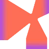

# I`m Kenyka

Frontend **Next.JS** and Backend **Python/C++**

Building projects for 4+ years, have my own development studio **[@Qualsu](https://github.com/qualsu)**

<b>Website with links: [thekeny.ru](https://thekeny.ru)</b>

## Education & Achievements

 Yandex Lyceum

- Studying on the course **"Industrial Programming in Python"**
- Completed the self-paced **Go course** (Go-1, Go-2, Go-3)

 PROD

- PROD ’26 — **finalist** (65 pts)
- PROD Hackathon Minsk — **4th place** (24 pts, Frontend 6/10)
- PROD Hackathon Saint Petersburg — **6th place** (27.5 pts, Frontend 9/10)

 DANO

- DANO Hackathon Saint Petersburg (Spring) — **21st place**
- DANO Hackathon Saint Petersburg (Autumn) — **5th place**

Other achievements

- **3rd-degree** prize winner of the regional Techno Storm competition
- **Finalist** in the «IT Professions of the Future: Test Engineer» case tournament by MGBOT

## Tech Stack

 

## GitHub Stats

